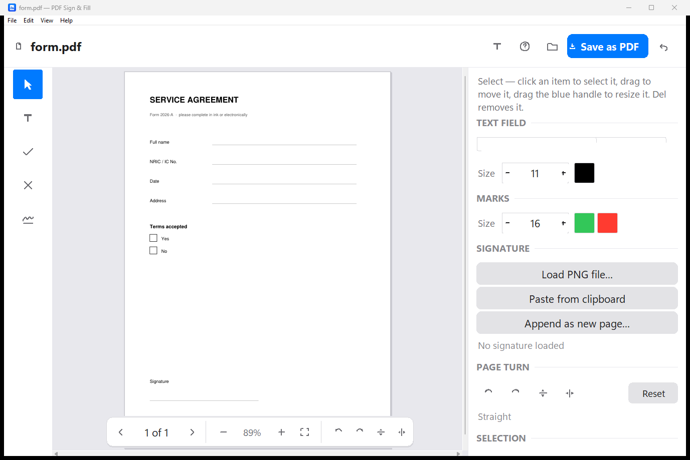

# PDF Sign & Fill

**Version 1.1.0** · [changelog](CHANGELOG.md) · [releases](https://github.com/isoenthusiast/orr-win-pdf/releases)

A small Windows desktop app to **open a PDF and sign/fill it**:

> **Open source, free software.** No pre-built binaries are published here —
> build your own copy with `build_exe.bat` (or run it straight from source
> with `run.bat`). Licensed under AGPL-3.0; see [Licence](#licence).

| what you asked for | how it works |
|---|---|
| append a PNG signature | load a transparent PNG (or paste one from the clipboard), click to place it, drag to position, drag the handle to resize |
| put text in forms to fill them | Text tool → click on the ruled line (the click is the **text baseline**, so the text lands on the line) → type in the sidebar; the text is burned into the PDF on save |
| put a check mark or an X over the PDF | Check / Cross tools → click where the mark belongs; size and colour are configurable |
| turn a page | rotate left / right, flip upside down / left to right — the turn is saved with the file |
| open PDFs | built-in viewer: page navigation, zoom, fit-to-window |

Everything is flattened into the saved PDF, so the result opens in any reader
with no viewer-specific markup.

---

## Using it

The app has a **built-in guide**: `Help ▸ How to use…`, or the `?` button in the
title bar. It explains every feature and shortcut, and stays open while you
work.

| action | how |
|---|---|
| Open | `Open` button / `Ctrl+O`, or `python app.py file.pdf` |
| Place something | pick a tool in the left rail, then click on the page |
| Select | click the item — clicking an item never adds a second copy |
| Move / resize | drag the item; drag the **blue handle** in its bottom-right corner to resize |
| Edit text | click the text item (the caret jumps into the sidebar field) and type |
| Delete | select an item, press `Del` or right-click → Delete |
| Undo | `Ctrl+Z` |
| Turn the page | the four buttons under the page, or `View ▸ Turn page` |
| Zoom | mouse wheel, or the `−` / `+` / `Fit` buttons |
| Pages | `◀` / `▶`, the page box, or `PgUp` / `PgDn` |

Keyboard shortcuts: `V` select · `T` text · `C` check · `X` cross ·
`S` signature · `Ctrl+S` save · `Ctrl+Z` undo.

The single-letter shortcuts are **ignored while you are typing** in the text
field, so a word is never mistaken for a command.

**Save** writes a *new* PDF (`<name>_signed.pdf`); the file you opened is
never modified. Saving twice never applies an edit twice.

### The interaction model

Clicking and dragging are deliberately distinct, because they are what people
expect from a native app:

| you do | you get |
|---|---|
| click an existing item | it is **selected** (never duplicated) |
| click empty space with a tool active | a **new** item is placed there |
| drag an item | it is **moved** |
| drag the blue corner handle | it is **resized** (hold `Shift` to stretch a signature freely) |
| click a text item again | the caret lands in the sidebar field so you can type |
| press `Del` | the selected item is deleted |

A click without movement does nothing at all — it does not create an undo step
and does not mark the file as edited.

### Turning a page

The four buttons under the page turn it like a sheet of paper, and `Reset` puts
it back. The turn is **saved**: the exported PDF really is rotated (the page
content is rewritten, not just turned on screen), and it looks the same in
every reader.

Anything you have already added travels with the page and stays upright and
readable — it is the page underneath that turns, not your writing.

### Opening PDFs

Three ways in, and the last two are optional:

| | how |
|---|---|
| drag and drop | **drag a PDF from Explorer onto the app** and it opens, with the window showing that a drop will be taken |
| the file menu | `File ▸ Make default PDF app…` registers the app, then walks you through Windows' own "Open with" dialog — tick *Always use this app* |
| by hand | `File ▸ Windows default apps…` opens Settings ▸ Apps ▸ Default apps |

Making the app the default is a per-user change: it writes to your own
registry (`HKCU`), needs no administrator rights, and is undone the same way.

### Making the text bigger

The interface text can be resized at any time — the **T button** in the title
bar, or `View ▸ Interface text size`. There are five sizes, from *Small* to
*Largest*, and the choice is remembered, so the app comes up the same way next
time. Everything scales with it: the panels, the buttons, the floating bar and
the icon rail.



### If something goes wrong

The app never disappears without saying something:

* a crash is written to `%APPDATA%\PDF Sign & Fill\error.log`, and the window
  that appears tells you where that file is;
* `app.py --doctor` (or `PDF Sign and Fill.exe --doctor`) prints a report of
  everything this PC is missing — Python, Tk, PyMuPDF, Pillow, fonts, and the
  Visual C++ runtime the PDF engine needs;
* opening a file that is password protected, damaged, or missing tells you
  which of those it is, in words, instead of printing a raw error.

---

**Python 3.10+ · PyMuPDF · Tkinter · Pillow** — 2 third-party packages, no
build step, no installer, ~40 MB of dependencies.

```powershell
python -m venv .venv
.\.venv\Scripts\pip install -r requirements.txt
.\.venv\Scripts\python app.py
```

Or just double-click **`run.bat`** — it creates the virtualenv on first run.

### Why not something heavier

| option | verdict |
|---|---|
| **Python + PyMuPDF + Tkinter** ✅ | One dependency does all four edits *and* the rendering. Tkinter ships with Python, so there is no UI framework to install, no build tool, no bundler. The whole app is ~2 000 lines of readable Python you can edit with Notepad. |
| Python + PyMuPDF + pywebview/HTML | Prettier interface, but adds a JS/HTML layer and a second runtime. Worth it only if the look matters more than the simplicity. `pdfedit/engine.py` is UI-agnostic, so the UI can be swapped without touching the PDF logic. |
| C# / WPF + PDFium | A genuinely native app, but it needs the .NET SDK, a Windows-only build chain and a much larger dependency tree. There is no .NET SDK on this machine today. |
| Electron + pdf.js | Heavyest option: ~200 MB of runtime for a tool that needs a canvas, a file dialog and four buttons. |
| `pypdf` / `pdf-lib` only | Cannot render pages, so no preview and no reliable WYSIWYG placement. |
| Adobe Acrobat / Foxit | Already solve this — but they are heavy, naggy and cannot be scripted the way this can. |

**Licence note:** PyMuPDF is AGPL-3.0. For personal or internal use that is
fine; if you ever ship this as a product, either buy a PyMuPDF licence or swap
the engine for a non-AGPL alternative (the `pdfedit/engine.py` API is small
enough to port).

---

## Using it

| action | how |
|---|---|
| Open | `Open` button / `Ctrl+O`, or `python app.py file.pdf` |
| Move / resize | `Select` tool, drag the item; drag the **orange handle** to resize |
| Edit text | double-click a text item, or select it and type in the sidebar |
| Delete | select an item, press `Del` or right-click → Delete |
| Undo | `Ctrl+Z` |
| Zoom | mouse wheel, or the `−` / `+` / `Fit` buttons |
| Pages | `◀` / `▶`, the page box, or `PgUp` / `PgDn` |

Keyboard shortcuts: `V` select · `T` text · `C` check · `X` cross ·
`S` signature · `Ctrl+S` save · `Ctrl+Z` undo.

**Save** writes a *new* PDF (`<name>_signed.pdf`); the file you opened is
never modified. Saving twice never applies an edit twice.

---

## Layout

```
app.py                 Tkinter shell: title bar, rail, canvas, inspector
pdfedit/theme.py       colours, type scale, spacing - the design tokens
pdfedit/widgets.py     rounded buttons, steppers, swatches, fields, tooltips
pdfedit/icons.py       the 23 vector icons
pdfedit/engine.py      the PDF engine (no UI imports) - overlays, export
pdfedit/transform.py   page rotation / flip maths (visible space + PDF space)
pdfedit/help.py        the built-in guide (Help ▸ How to use)
pdfedit/assoc.py       .pdf file association (Windows registry, per user)
pdfedit/prefs.py       the small JSON settings file in %APPDATA%
pdfedit/dialog.py      the themed "make this the default?" dialogs
pdfedit/diagnostics.py the system check behind `app.py --doctor`
pdfedit/dnd.py         drop a PDF from Explorer onto the window
pdfedit/__init__.py
tools/make_demo.py     generates a demo form + signature PNG to try it with
tools/make_icon.py     generates app.ico
tools/pdfsign.spec     PyInstaller build for the standalone .exe
tools/verify_exe.py    checks a packaged build (headless + GUI screenshot)
tools/check_exe_deps.py reads the .exe import table: is anything missing?
tests/test_engine.py   16 engine tests, incl. rotation and the rotated-page test
tests/test_ui_clicks.py 21 click-by-click interaction tests
tests/test_ui_smoke.py 5 UI tests: drives the real app and screenshots it
tests/test_assoc.py    15 tests for the file association and the settings file
tests/test_dnd.py      8 tests for dropping a PDF from Explorer
tests/test_diagnostics.py 13 tests for the system check and the text scaling
tests/screenshot.py    window capture helper (works without a live desktop)
docs/ROTATION.md       why rotated pages need special care
docs/icon-sheet.png    every icon in one image
docs/screenshot.png    the packaged app, running
docs/app-text-normal.png   the interface at the normal text size
docs/app-text-largest.png  the interface at the largest text size
docs/prompt-default-app.png  the "make this the default PDF app?" offer
LICENSE                GNU Affero General Public License v3.0
CHANGELOG.md           what changed in each version
run.bat                one-click launcher (sets up the venv on first run)
build_exe.bat          one-click packaging into dist\
```

The engine keeps a list of **overlays** (the edits) in *visible page
coordinates* and only burns them into the PDF on export. The source file is
re-opened from disk for every export, so an export is always reproducible and
the original is never touched.

---

## The interface

The look is built around one idea: **the page is the product, the chrome is
quiet**. Three surfaces, one accent colour, no decoration that isn't
load-bearing.

```
┌──────────────────────────────────────────────────────────────┐
│  ▤ form.pdf ●                                   📂  ⤓ Save  │  title bar
├────┬─────────────────────────────────────────┬───────────────┤
│ ⌖  │                                         │  hint         │
│ T  │            the page, centred            │  TEXT FIELD   │
│ ✓  │            with a soft shadow           │  MARKS        │
│ ✕  │                                         │  SIGNATURE    │
│ ∿  │                                         │  SELECTION    │
│    │      ‹  1 of 3  ›  |  −  89%  +  ⛶      │               │
└────┴─────────────────────────────────────────┴───────────────┘
   rail          floating context bar          inspector
```

The real thing, captured from the packaged `.exe`:


| decision | why |
|---|---|
| **Icon rail** on the left instead of radio buttons | a tool is a mode, and modes belong in a rail; the active tool gets a filled blue tile, like Xcode / Keynote |
| **Floating context bar** over the page | page and zoom live where the page is, instead of crowding the title bar (what macOS Preview does) |
| **Inspector** on the right, uppercase grey section headers | one place for everything about the current tool and selection; the header rule carries the grouping without boxes |
| **Custom-drawn controls** | Tk's stock widgets are the single biggest reason an app looks dated. Every control here is drawn on a canvas: rounded corners, hairline borders, hover and pressed states |
| **Vector icons** (`pdfedit/icons.py`) | 23 glyphs authored in a 24×24 grid with one optical weight — no icon font, no image assets, no blurring at any zoom |
| **One accent colour** (#007AFF) | selection handles, active tool, focus rings — nothing competes with the page |
| **Segoe UI Variable** | the closest match to SF Pro that ships with Windows 11 |
| **Page on a soft shadow**, centred when it fits | the document reads as a sheet of paper, not a screenshot |
| **Empty state** | first run shows "Open a PDF to begin" instead of a blank canvas |

Colours, type and spacing live in `pdfedit/theme.py`, the controls in
`pdfedit/widgets.py`, the glyphs in `pdfedit/icons.py`. Re-skinning the whole
app means editing one file. `docs/icon-sheet.png` shows every glyph.

---

## Try it

```powershell
.\.venv\Scripts\python tools\make_demo.py     # writes demo_form.pdf + demo_signature.png
.\.venv\Scripts\python app.py demo_form.pdf
```

`demo_signed.pdf` in this folder shows the result of filling and signing the
demo form, and `demo_rotated.pdf` is a page that arrives with a `/Rotate 90`
already on it — the case where marks have to land on the page you can *see*
rather than the page in the file.

---

## Package as a standalone .exe

```powershell
build_exe.bat
```

Produces **`dist\PDF Sign and Fill.exe`** — one self-contained file, **~33 MB**,
that runs on any 64-bit Windows machine with no Python installed.

No binaries are published in this repository: build your own copy, so the
thing you run is one you built and can audit. If you do redistribute a
built copy, the AGPL requires the corresponding source and the licence to
travel with it — this repository *is* the corresponding source.

### Running it on a new Windows 11 PC

The `.exe` needs nothing installed. It is a 64-bit build (it runs on x64 and
on ARM Windows 11 through emulation) and it **carries the Microsoft Visual
C++ runtime with it** — the PDF engine is C++, and Windows 11 does not ship
that runtime, so a build that left it out would fail to start on a clean
machine with `MSVCP140.dll was not found`.

| | requirement |
|---|---|
| Windows | 10 or 11, 64-bit |
| Installed | nothing — no Python, no runtime, no .NET |
| Internet | not needed |
| Disk | ~35 MB for the .exe, ~120 MB while it unpacks itself into `%TEMP%` |

If you build it from source instead, `run.bat` does the work: it finds
Python 3.11+, creates a virtualenv and installs the two packages. The first
run needs an internet connection; after that it does not.

**If Windows shows a blue warning instead of opening the app**, that is
SmartScreen: the build is not signed, so Windows cannot vouch for it. Click
*More info* → *Run anyway*. (Signing it properly costs a code-signing
certificate per year; for a personal tool this is the honest trade.)

**To check a PC before handing it over**, run the .exe with `--doctor`:

```
"PDF Sign and Fill.exe" --doctor
```

It prints — or, in the windowed build, writes to
`%APPDATA%\PDF Sign and Fill\doctor-report.txt` — exactly what that machine
has and what it is missing. The build does the same check on itself:
`tools/check_exe_deps.py` reads the import table of the finished `.exe` and
fails the build if anything is missing.

| | |
|---|---|
| Build | `tools/pdfsign.spec` (PyInstaller, onefile) |
| Verify | `tools/verify_exe.py` — runs the exe headless, then launches the GUI and screenshots it |
| Headless check | `app.py --selftest in.pdf out.pdf` — open, edit, export, then read the result back and exercise Pillow |

### Is it really portable? Yes — here is the proof

The exe was copied to a scratch folder and run with

* the app's own source (`app.py` and the `pdfedit` package) **renamed away**, so
  nothing could be imported from the source tree;
* `PATH` set to `C:\Windows\System32` only — no Python anywhere on it;
* the working directory set to the scratch folder, not the project.

It still opened a PDF, edited it, exported a valid PDF, and brought up its
window. Then every DLL the running process had loaded was enumerated with
`EnumProcessModules`:

| | |
|---|---|
| modules loaded | all from the exe's own unpacked bundle (`%TEMP%\_MEI…`) or from `C:\Windows` |
| leaked from a Python install | **none** |
| leaked from the project folder | **none** |

The bundle it unpacks into contains everything the app needs:

| file | what it is |
|---|---|
| `pymupdf\mupdfcpp64.dll` + `pymupdf\_mupdf.pyd` | the MuPDF engine (the PDF work) |
| `python314.dll` + `base_library.zip` | the bundled interpreter and standard library |
| `tcl86t.dll`, `tk86t.dll`, `_tkinter.pyd` | the Tk runtime (the UI) |
| `PIL\_imaging*.pyd` | Pillow (the signature preview) |
| `msvcp140.dll`, `vcruntime140*.dll` | the Visual C++ runtime, **carried with the app** |

So the answer to "is it independent of dependent libraries?" is **yes**: the only
thing it needs from the machine is Windows itself.

The Visual C++ runtime is the one that needs saying twice, because Windows
11 does **not** ship it — it only exists on a PC where somebody installed the
redistributable. MuPDF's engine is C++ and imports `MSVCP140.dll`, so a build
that relied on the machine having it would start perfectly on the developer's
PC and then fail on a clean one with *"MSVCP140.dll was not found"*. The spec
therefore bundles the runtime with the app, and `tools/check_exe_deps.py`
reads the finished `.exe`'s import table to prove that nothing else is
missing.

Two things the spec deliberately keeps out, which together save ~50 MB:

- **PyMuPDF's ONNX layout models** (~40 MB) — this app never runs table or
  layout detection. PyInstaller's hooks pull them in from the package tree,
  so the spec strips them from the analysis afterwards.
- **Pillow's AVIF / WebP / TIFF codecs** — PNG is the only format the app reads.
- **MuPDF's C headers and import libraries** (~6 MB) — nothing compiles at runtime.

Two practical notes:

- A onefile exe unpacks itself into `%TEMP%` on every launch, so startup is
  roughly a second slower than running from source. For a folder build
  (faster start, easier to patch), switch the spec from the onefile `EXE(...)`
  to `COLLECT(...)`.
- The build needs `pyinstaller`, which is *not* in `requirements.txt` — it is a
  build-time dependency only, and `build_exe.bat` installs it for you.

## Tests

```powershell
.\.venv\Scripts\python -m unittest discover -s tests -v
```

82 tests, ~3 seconds:

* **16 engine tests** — the exported PDF really contains the text/image/marks,
  the source file is untouched, exporting twice is idempotent, every mark
  lands **exactly** where it was clicked (including on `/Rotate 90` pages, see
  `docs/ROTATION.md`), a turned page is saved turned, and the preview matches
  the export pixel for pixel.
* **23 click-by-click tests** — these drive the *real* Tk bindings with
  `event_generate`, the same path a mouse takes, and assert the state after
  every single click: click to select (never to append), click empty space to
  append, drag to move, drag the corner handle to resize, `Del` to delete,
  `Ctrl+Z` to undo, letter shortcuts ignored while typing, a click without
  movement creating no undo step, the text-size control resizing the fonts,
  and a dropped PDF opening like a double-click.
* **5 UI smoke tests** — open the demo form, drop a text field, a tick, a
  cross and a signature through the actual handlers, export, and screenshot
  the running app.
* **15 association tests** — the registry entries are written, read back and
  removed again (in a throw-away key, never the real `.pdf` one), and
  another app's choice is left alone.
* **8 drag-and-drop tests** — the file names are read out of a `CF_HDROP`
  handle built by hand, exactly as Explorer's drop delivers them.
* **13 system-check tests** — the report covers every prerequisite, the
  machine running the tests passes its own check, and the text scaling
  survives being turned up and back down.
* **5 version tests** — the number in the About box, the README and the
  changelog cannot drift apart.

---

## Reporting a security problem

**Please don't open a public issue for a security bug.** Use GitHub's private
reporting instead — **Security ▸ Report a vulnerability** on this repository
— which opens a private thread between you and the maintainer, so a fix can
be agreed and shipped before anything is public. The full policy is in
[`.github/SECURITY.md`](.github/SECURITY.md).

---

## Licence

**GNU Affero General Public License v3.0 or later** — the full text is in
[`LICENSE`](LICENSE), and the app shows the same notice in
`Help ▸ About` and in the built-in guide.

AGPL-3.0 is not a formality here: PyMuPDF, which does all the PDF work, is
itself AGPL-3.0, and this app links it. So the whole program is AGPL-3.0.

What that means in practice:

- you may use it, study it, change it and share it, for any purpose;
- if you **ship** a copy — an `.exe`, a fork, a modified build — you must
  pass on this licence, keep the notices intact, and make the corresponding
  source available (this repository satisfies that);
- the app has no network features, so the AGPL's network-use clause (§13)
  does not bite: there is no server to offer source to.

Bundled third-party code keeps its own licence: PyMuPDF (AGPL-3.0, © Artifex
Software, Inc.), Pillow (MIT-CMU), Python (PSF), Tk (Tcl/Tk BSD-style).

This project is free software and is not intended for commercial use.

---

## Adding a feature

Everything hangs off `Overlay` and `PdfDocument.export()`. A new kind of mark
needs three small pieces:

1. a `kind` constant and a new `Overlay` field in `pdfedit/engine.py`;
2. an `add_*` method and a `_burn_*` method in `PdfDocument`;
3. a case in `app.py::draw_overlay` plus a tool button.

`draw_overlay()` draws the screen preview; `_burn_*()` draws the real thing
into the PDF. Keep their geometry in sync — `pdfedit/engine.py` holds the
shared helpers (`check_segments`, `cross_segments`, `text_box_size`) so both
use the same numbers.
